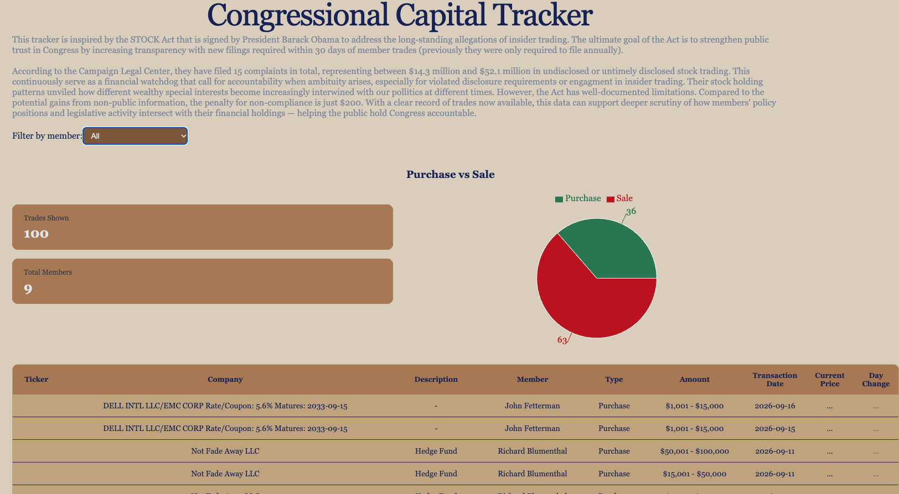
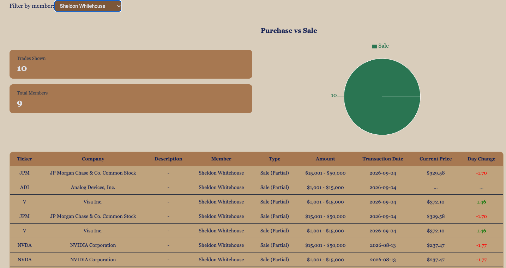

# Congressional Capital Tracker

**🔗 Live Demo: [capitaltracker-ruddy.vercel.app](https://capitaltracker-ruddy.vercel.app/)**

A full-stack transparency dashboard for U.S. congressional stock trades, with live market prices. Built with a React frontend, an Express backend, and a PostgreSQL caching layer to stay within API rate limits.

**Available endpoints:**
- `/api/trades`
- `/api/prices`




## What It Does

Members of Congress have access to non-public information that opportunists could exploit while serving in public office. Effective public scrutiny helps close that information gap and lets citizens monitor how legislators' financial activity intersects with their policy roles.

Capital Tracker surfaces publicly disclosed stock trades made by members of the U.S. Senate (filed under the STOCK Act) and pairs each trade with live market prices. Users can browse the latest trades across all members, filter to a specific senator, and see a breakdown of their buy/sell activity.

## Why I Built It

After years in institutional consulting and financial services, I repeatedly saw how reluctant organizations can be to disclose conflicts of interest — and how much that opacity can cost the public. That concern carried over as I transitioned into software engineering. I wanted a project that combined real public-interest data with the API-integration and data-handling challenges that production apps actually face. The congressional-trades domain let me apply my financial-data instincts while learning modern full-stack development.

## Features

1. **Individual-level filter** — drill into a single senator's disclosed trades.
   - Stops API calls when "All" members are selected, to preserve quota.
2. **Live trade feed & market prices** — the most recent Senate trades, pulled from a real financial-data API, with current prices and day change layered onto each holding.
   - Batches price calls when a member is selected, and fetches duplicate tickers only once.
3. **Server-side caching** — trades and per-ticker prices are cached in PostgreSQL; the external API is only hit when data is older than the cache window, keeping the app within the provider's free-tier rate limits.
4. **Hidden API key** — the external API key lives only on the backend in environment variables, and is gitignored as a safety measure. The frontend ships no confidential credentials.
5. **Allocation chart** — a visual buy/sell breakdown (Recharts).
6. **Graceful handling of data issues** — displays loading, error, and empty states, and parses messy disclosure text into clean fields.

## Tech Stack

- **Frontend:** React, TypeScript, Vite
- **Backend:** Node.js, Express
- **Database:** PostgreSQL (hosted on Neon)
- **Charts:** Recharts
- **Data:** Financial Modeling Prep API (Senate trades, Batch Quote Short)
- **Deployment:** Frontend on Vercel, backend + database on Render and Neon

## Architecture

This is a three-tier application, not a frontend calling an API directly:

| Layer | Platform | Role |
|---|---|---|
| React (TypeScript + Vite) | Vercel | **Frontend.** Renders the dashboard, handles filtering and the allocation chart. Calls only my own backend — never the external API directly. |
| Express API + Node | Render | **Backend.** Exposes `/api/trades` and `/api/prices`. Holds the external API key server-side as a gatekeeper and owns all external data fetching. |
| PostgreSQL cache | Neon | **Caching layer.** JSON responses are stored with a timestamp. The backend serves cached data when it's fresh and only re-fetches from the API when it's stale (>60 min). |
| Financial Modeling Prep API | — | **Source.** External data provider. |

- **Two-source data design:** a primary API call fetches all disclosed trades; a second fetches live prices only for the symbols currently in view, to stay within free-tier rate limits.
- **Quota-aware fetching:** prices are only requested when a specific member is selected (not for the full feed), deliberately trading completeness for API-budget efficiency.
- **Defensive data parsing:** disclosure descriptions arrive in several inconsistent formats; the app parses company name and description out of them and falls back gracefully when a format doesn't match.

## Engineering Decisions

- **Caching layer to respect rate limits:** rather than calling the external API on every render, the backend stores responses in PostgreSQL and serves them until the configurable window expires. Fetching once per window greatly reduces unnecessary calls — a practical solution to preserve quota limits.
- **Parameterized SQL:** all database writes use parameterized queries (`$1, $2` placeholders), never string interpolation, to prevent SQL injection.
- **Configurable API URL:** the frontend reads its backend URL from an environment variable with a localhost fallback, so the same codebase runs locally and in production without edits.
- **Timezone-safe freshness checks:** cache age is computed in the database (`EXTRACT(EPOCH FROM (NOW() - cached_at))`) rather than in JavaScript, to avoid cross-system timezone bugs.

## Known Limitations

- Live prices are available only for the symbols included in the data provider's free tier; others display "…". Some transactions don't return valid ticker data when the instrument is private debt or a secondary trade.
  - The FMP quote API only makes prices available for a set of top trending tickers on the free plan.
- The free API tier caps daily requests, so heavy use may temporarily exhaust the quota and return a 429 status code.
- The backend is hosted on a free tier that sleeps after inactivity, so the **first request after an idle period takes ~50 seconds** to wake the server (cold start). Subsequent requests — and anything served from cache — are fast.

## Running Locally

This is two repositories: a frontend and a backend.

**Backend** ([capital_tracker_api](https://github.com/gulgicheese/capital_tracker_api)):
```bash
git clone https://github.com/gulgicheese/capital_tracker_api.git
cd capital_tracker_api
npm install

# create a .env file with:
#   FMP_KEY=your_fmp_key
#   DATABASE_URL=your_postgres_connection_string

npm start      # runs on http://localhost:3000
```

**Frontend** (this repo):
```bash
git clone https://github.com/gulgicheese/[frontend-repo].git
cd [frontend-folder]
npm install
npm run dev    # runs on http://localhost:5173, defaults to the localhost backend
```

Get a free API key at [Financial Modeling Prep](https://site.financialmodelingprep.com); create a free PostgreSQL database at [Neon](https://neon.tech).

## What I Learned

- Building a REST API from scratch with Express (routes, middleware, status codes, error handling).
- Designing a PostgreSQL caching layer, including freshness checks and upserts (`ON CONFLICT`).
- Writing type-safe React with TypeScript, using types as data contracts to catch bugs before runtime.
- Synchronizing a frontend with a backend across environments (CORS, environment variables, deployment).
- Preventing SQL injection with parameterized queries, and debugging a real cross-system timezone bug.
- Handling genuinely messy real-world data rather than clean sample data.

### Next Steps

- User accounts and saved watchlists (JWT auth)
- Per-member historical performance over time
- More complete price coverage via a different data provider
- A keep-warm ping or paid tier to eliminate backend cold starts

---

*Trade data sourced from public STOCK Act disclosures. For informational purposes only — not investment advice.*
